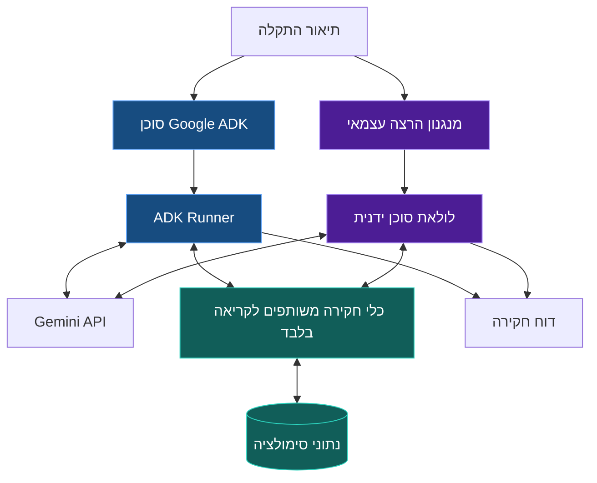
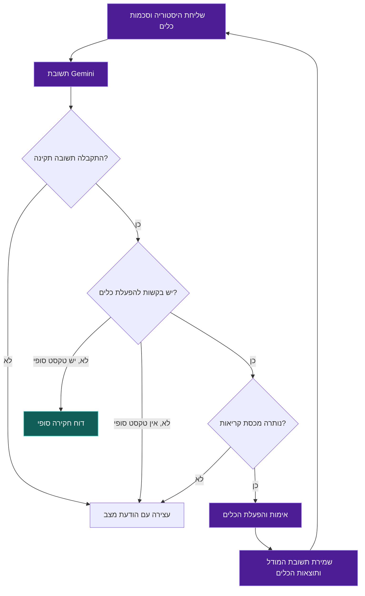

<div align="center" dir="rtl">

# 🔎 חוקר תקלות מבוסס בינה מלאכותית

**AI Incident Investigator**

חקירה מבוססת ראיות · שתי ארכיטקטורות של סוכנים · מערכת כלים משותפת


</div>

<div dir="rtl">

## 🎯 על הפרויקט

פרויקט לימודי בשפת פייתון, המדמה חקירת תקלות במערכת מסחר אלקטרוני באמצעות מודל Gemini. הסוכן אוסף ראיות ממדדי השירותים, מיומני המערכת ומשינויי תצורה אחרונים, מזהה גורמים אפשריים לתקלה ומפיק דוח חקירה מובנה.

מטרת הפרויקט היא להבין כיצד פועלים סוכני בינה מלאכותית, באמצעות שני מימושים של אותה משימה:

- **Google ADK:** שימוש בספריית סוכנים שמנהלת את לולאת החקירה, הפעלת הכלים והיסטוריית השיחה.
- **Custom Harness:** בניית מנגנון הרצה עצמאי באמצעות ספריית הלקוח של גוגל, תוך ביטול ההפעלה האוטומטית של פונקציות וניהול הלולאה בקוד פייתון.

שני המימושים משתמשים באותם כלים, נתוני סימולציה והנחיות מערכת. המודל בוחר את פעולות החקירה בהתאם לראיות שנאספות בזמן הריצה, ולא לפי סדר פעולות קבוע מראש.

## 🧠 ארכיטקטורת המערכת

</div>



<div dir="rtl">

### כלי החקירה

| כלי | תפקיד |
| --- | ---: |
| `get_service_status(service)` | בדיקת מצב השירות ומדדי התפקוד שלו |
| `search_logs(service, keyword)` | חיפוש ראיות ביומני השירות לפי מילת מפתח |
| `get_recent_changes(service)` | בדיקת שינויי תצורה או פריסות אחרונות |

ארבעת השירותים הנבדקים: שער הגישה, שירות ההזמנות, מסד הנתונים ושירות התשלומים.

</div>

```text
gateway | orders | database | payments
```

<div dir="rtl">

### לולאת הסוכן העצמאית

מנגנון ההרצה שולח את ההיסטוריה ואת סכמות הכלים למודל. כאשר המודל מבקש להפעיל כלים, המנגנון בודק את הבקשות, מפעיל את הכלים המורשים ומחזיר את התוצאות כחלק מההיסטוריה. התהליך נמשך עד לקבלת תשובה סופית או להגעה לתנאי עצירה.

</div>



<div dir="rtl">

## 🛡️ אמינות, הגנה ותיעוד פעולות

- **Least Privilege:** כלים לקריאה בלבד ורשימה מפורשת של כלים מורשים במימוש העצמאי.
- **Guardrails:** אימות פרמטרים בזמן הריצה והחזרת הודעות שגיאה מובנות.
- **Execution Budget:** מגבלה של 10 קריאות למודל לכל ניסיון חקירה.
- **Model Fallback:** מעבר למודל חלופי במקרה של שגיאות זמינות או מכסה (429, 503).
- **Observability:** תיעוד קריאות למודל, שמות הכלים, פרמטרים, תוצאות ותנאי עצירה בטרמינל.
- **Callbacks:** פונקציות בקרה ותיעוד במימוש באמצעות ADK; במימוש העצמאי התיעוד נכתב ישירות בקוד.
- **Context Engineering:** ניהול היסטוריית השיחה ושמירת הראיות שנאספו.
- **Uncertainty Handling:** הנחיה להבחין בין עובדות להשערות ולהציג את רמת הביטחון במסקנות.

## 📂 מבנה הפרויקט

</div>

```text
incident-investigator/
├── sdk_agent.py
├── custom_agent.py
├── tools.py
├── mock_data.py
├── prompts.py
├── test_custom_agent.py
├── run_scenario.py
├── run_uncertain_scenario.py
├── requirements.txt
├── .env.example
├── .gitignore
└── README.md
```

<div dir="rtl">

| קובץ | תפקיד |
| --- | ---: |
| `sdk_agent.py` | מימוש הסוכן באמצעות Google ADK |
| `custom_agent.py` | מנגנון הרצה עצמאי |
| `tools.py` | פונקציות החקירה המשותפות |
| `mock_data.py` | נתוני המערכת המדומה |
| `prompts.py` | הנחיות מערכת משותפות |
| `test_custom_agent.py` | בדיקות מקומיות ותרחישי כשל מדומים |
| `run_scenario.py` | תרחיש תקלה בשירות התשלומים |
| `run_uncertain_scenario.py` | תרחיש של ראיות לא מספיקות |
| `requirements.txt` | ספריות נדרשות |
| `.env.example` | תבנית לקובץ הגדרות מקומי |
| `.gitignore` | החרגת קבצים רגישים וקבצים מקומיים |
| `README.md` | תיעוד הפרויקט |

## 🚀 התקנה והרצה

### דרישות מקדימות

נדרשים פייתון, Git ומפתח גישה לממשק Gemini. הפרויקט פותח ונבדק בסביבת Windows עם פייתון בגרסה 3.13.

### 1. הורדת הפרויקט והתקנת התלויות

</div>

```powershell
git clone https://github.com/zr0548582894-blip/incident-investigator.git
cd incident-investigator
python -m venv .venv
.\.venv\Scripts\Activate.ps1
python -m pip install -r requirements.txt
```

<div dir="rtl">

### 2. הגדרת מפתח הגישה

יש ליצור קובץ סביבה מקומי מתוך קובץ הדוגמה:

</div>

```powershell
Copy-Item .env.example .env
```

<div dir="rtl">

יש ליצור מפתח גישה אישי ב־[Google AI Studio](https://aistudio.google.com/api-keys) ולהחליף את הערך לדוגמה בקובץ הסביבה. אין להעלות מפתח גישה אמיתי למאגר.

רשימות המודלים והעדפות המעבר ביניהם מוגדרות במשתנה `MODEL_NAMES` בשני קובצי הסוכנים.

### 3. הפעלת הסוכן באמצעות ספריית הסוכנים

</div>

```powershell
python sdk_agent.py
```

<div dir="rtl">

### 4. הפעלת הסוכן העצמאי

</div>

```powershell
python custom_agent.py
```

<div dir="rtl">

דוגמה למשימה שאפשר להזין בשני המימושים:

> לקוחות מדווחים שהם לא מצליחים לבצע הזמנות. חקור את התקלה ומצא את הגורם הסביר ביותר.

דוח החקירה כולל חמישה חלקים: תקציר האירוע, ראיות שנאספו, הגורם הסביר ביותר, רמת ביטחון ואי־ודאויות, והמלצות להמשך. הסוכן מונחה להשיב בשפת המשתמש.

## 🧪 בדיקות והערכת ביצועים

### בדיקות מקומיות ללא קריאה למודל

</div>

```powershell
python test_custom_agent.py
```

<div dir="rtl">

במהלך הפיתוח עברו בהצלחה שבע בדיקות:

| בדיקה | תוצאה שנצפתה |
| ---: | --- |
| הפעלת כלי תקין | ✅ התקבלו נתונים |
| בקשת כלי שאינו מורשה | ✅ הבקשה נדחתה |
| שירות שאינו קיים | ✅ התקבלה שגיאה |
| סוג פרמטר שגוי | ✅ התקבלה שגיאה |
| פרמטר חסר | ✅ התקבלה שגיאה |
| אכיפת מגבלת הקריאות | ✅ החקירה נעצרה במגבלה |
| מעבר למודל חלופי | ✅ עבר בבדיקת כשל מדומה |

### תרחישי חקירה נוספים

</div>

```powershell
python run_scenario.py sdk
python run_scenario.py custom
python run_uncertain_scenario.py sdk
python run_uncertain_scenario.py custom
```

<div dir="rtl">

בתרחיש התשלומים יש להזין בקשה לחקירת תשלומים שנכשלו. בתרחיש הראיות החסרות יש להזין בקשה לחקירת כשל בביצוע הזמנות.

### תוצאות ההרצות בפועל

| תרחיש | קריאות ADK | קריאות Custom | כלים ADK | כלים Custom |
| ---: | ---: | ---: | ---: | ---: |
| מיצוי חיבורים למסד הנתונים | 3 | 4 | 8 | 8 |
| כשל באימות מול ספק התשלומים | 4 | 3 | 10 | 4 |
| ראיות לא מספיקות | 4 | 5 | 8 | 10 |
| **סה״כ** | **11** | **12** | **26** | **22** |

כל שש החקירות הושלמו. הספירה מתייחסת לניסיונות החקירה המוצלחים ואינה כוללת קריאת ADK נוספת שנכשלה עקב עומס אצל ספק המודל.

בתרחיש התשלומים נעשה שימוש במודלים שונים בשני המימושים. התוצאות הן תצפיות מהרצות לימודיות, ולא ניסוי ביצועים מבוקר או הוכחה ליתרון עקבי של אחד המימושים.

שני הסוכנים זיהו את הגורמים הסבירים בשני התרחישים הראשונים. בתרחיש השלישי הם הכירו בכך שהראיות חסרות, אך נדרש שיפור בהצגת רמת הביטחון ובהימנעות מהסקת מסקנות סיבתיות שאינן מבוססות מספיק.

## ⚖️ השוואה בין שתי הארכיטקטורות

| יכולת | Google ADK | Custom Harness |
| ---: | --- | --- |
| לולאת הסוכן | מנוהלת בספרייה | לולאת פייתון מפורשת |
| סכמות כלים | נוצרות מתוך הפונקציות | מוגדרות ידנית |
| איתור והפעלת כלים | מנוהלים בספרייה | מילון כלים ומנגנון הפעלה עצמאי |
| ניהול ההקשר | שירות ניהול סשנים | רשימת הודעות בזיכרון |
| תיעוד הפעולות | Callbacks | הדפסות ישירות |
| מגבלת קריאות | הגדרה בספרייה | אכיפה בתוך הלולאה |
| יתרון מרכזי | פחות קוד תשתיתי | שליטה ושקיפות גבוהות יותר |
| מחיר השימוש | תלות בהתנהגות הספרייה | יותר אחריות ותחזוקה |

## 📌 מגבלות וכיוונים לשיפור

- המערכת פועלת על נתונים מדומים בלבד ואינה מחוברת לסביבת ייצור או מבצעת פעולות תיקון.
- מנגנון המעבר למודל חלופי במימוש העצמאי נבדק באמצעות כשל מדומה, ולא במהלך תקלה אמיתית אצל הספק.
- יש לשפר את הערכת רמת הביטחון ואת ההבחנה בין ראיות להשערות.
- ניתן להרחיב את הבדיקות האוטומטיות, להוסיף תיעוד מובנה ולבצע מדידות ביצועים חוזרות בתנאים זהים.

---

</div>

<div align="center" dir="rtl">

**נבנה במטרה להבין כיצד סוכני בינה מלאכותית פועלים גם מעבר לספריות הסוכנים.**

Python · Gemini · Google ADK · Agent Harness Engineering

</div>
